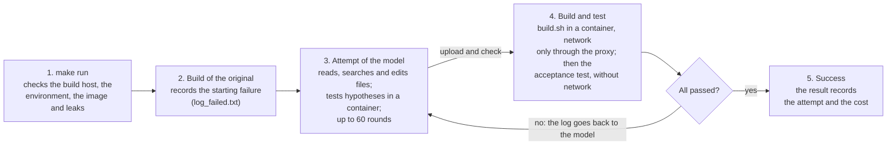

# Build-bench tutorial

How to install Build-bench, run and follow a benchmark on the Power9, read the
results and add new cases. Every command runs on the build host (the Power9),
in the repository's directory. The [README](../README.md) is the reference of
the framework; this is the walk-through.

## How a run works

A run goes through the packages one by one. For each package the model has a
fixed number of attempts, and each attempt has up to 60 rounds of tool calls.



When the rounds run out, the next attempt starts with the notes of the
previous one; after the last, the package counts as a failure. A build counts
as a success only when its acceptance test passes too.

## Installation

Set up Python, the credentials and Podman once per machine. The framework runs
as a normal user and changes nothing on the system. The repository is the
public fork [llm-pt-ibm/Build-bench](https://github.com/llm-pt-ibm/Build-bench)
of [zcyyc/Build-bench](https://github.com/zcyyc/Build-bench); the work is on
the `improvements` branch.

1. Clone the repository and install the Python dependencies.
2. Create `.env` at the root of the repository, with the variables of the table below. It never goes to git.
3. If the machine uses another Python or another data directory, create `local.mk` (also out of git).
4. Install Podman: builds, acceptance tests and the model's commands run in its containers.

```bash
git clone -b improvements https://github.com/llm-pt-ibm/Build-bench.git build-bench
cd build-bench
uv sync                                   # x86_64 and aarch64
pip install -r requirements-ppc64le.txt   # ppc64le, in a Python 3.11 environment
sudo dnf install podman                   # or: sudo apt install podman
```

| `.env` variable | What for |
|---|---|
| `API_KEY` | key of the model's API (e.g. OpenRouter's) |
| `API_BASE_URL` | address of the API, e.g. `https://openrouter.ai/api/v1` |
| `OBS_USER`, `OBS_PASSWORD` | OBS account, only for the OBS backend |

`.env` holds only credentials. The model, the provider, the temperature and
everything else are in `bench.yaml`, and `.env` does not override them: a
setting left empty in `bench.yaml`, or cleared with `none` on the `make`
command line, stays empty.

```make
# local.mk
PY = /root/miniforge3/envs/build_bench/bin/python
BENCH_HOME = /data/bench   # optional; the default is ~/.local/share/build-bench
```

`BENCH_HOME` holds what lives outside the repository: the build environments
(`envs/`), the build directories of the cases (`stage/`) and the local osc
worker. Without Podman, `runtime: auto` in `bench.yaml` uses Docker; whoever is
in Docker's group has root power.

## Build environment

Build-recipe cases (with a `build.sh`, like jaxlib and TensorFlow) build in a
build environment: what an x86_64 host would have ready and the Power9 lacks.
An environment is one file, `envs/<name>/env.yaml`, for any package and build
system; `make setup-env` does the rest, once per machine.

| Key | What it is |
|---|---|
| `conda` | conda packages of the build environment: compilers, build tools, libraries and languages (CMake, Rust, Go, Java, Python...) |
| `channels` | conda channels, in order (default: conda-forge) |
| `tools` | a second conda environment, for tools whose dependencies conflict with the build's |
| `system` | RHEL 8 packages (dnf) added to the image the builds run in |
| `env` | variables exported to builds, tests and commands; `$BENCH_ENV_DIR` is the environment's directory |
| `setup` | commands run once, at the end of the setup, for what no key covers |
| `bazel` | a Bazel version, compiled from its sources, since there is no binary for ppc64le |
| `wheels` | Python wheels PyPI lacks for the architecture, built with the environment's compilers |
| `build_pip`, `test_pip` | pip packages of the build environment and of the test one; a name in `wheels` comes from the built wheel |

Every key is optional: an environment can have only system packages, only
conda, or any combination. The Python keys need a Python in `conda`.

`envs/env.example.yaml` has every key, explained, and `make new-env ENV=<name>`
copies it to `envs/<name>/env.yaml`. `envs/tf-power9/env.yaml` is a complete
one, for TensorFlow.

```bash
make setup-env ENV=tf-power9   # needs conda (Miniforge); BAZEL_BINARY=<file> uses a Bazel compiled already
make check-env ENV=tf-power9   # loads the environment as a build does and shows what it provides
```

`setup-env` reads `env.yaml` and:

- creates the conda environments (build, tools and test); the first setup writes the locks (`build.lock`, `tools.lock`) with the exact packages, which the next ones install, and you commit them;
- compiles Bazel once per version, shared by the environments, and the wheels PyPI lacks for ppc64le, one at a time, each with its log;
- builds the container image, `build-bench-<name>`, from `envs/Containerfile` (or the environment's own `Containerfile`, if it has one).

The environment's `env.json` records versions, checksums and the image's id,
and every run result records that id. `check-env` should end with
`environment ready` and show the builds' network.

Builds, tests and the model's commands load the environment with
`scripts/script_worker/env.sh`, which only exports variables: `PYTHON`,
`TEST_PYTHON`, `CLANG`, `BAZEL`, `JAVA_HOME` and `LOCAL_WHEELS`, besides `PATH`
and the variables of `env`. An `envs/<name>.sh` replaces it, for an
environment that needs more.

## First run

Everything a run uses is in one file, `bench.yaml` at the root of the
repository; `make run` reads it and starts the run in the background. The
fields that change most from one run to the next:

```yaml
# bench.yaml (excerpt)
source_arch: x86_64                   # the cases build on this architecture
target_arch: ppc64le                  # and fail on this one: the model repairs them for it
packages: [jaxlib]                    # cases to run; empty = all of data/x86_64_to_ppc64le/
label: run31                          # name of the run; archived as run31_1
repeats: 1                            # how many times to repeat the run
model: deepseek/deepseek-v4.1-flash   # model on OpenRouter
provider: streamlake/fp8              # pinned provider (empty = OpenRouter's routing)
temperature:                          # empty = the provider's default
llm:
  max_build_attempts: 12              # build attempts per package
```

The fields of the run can also be changed on the command line, without
editing the file:

```bash
make run                                      # uses bench.yaml as it is
make run LABEL=run31 ATTEMPTS=6               # another name and number of attempts
make run PACKAGES=zita-resampler MODEL=anthropic/claude-haiku-5.5
make run-fg                                   # in the foreground (Ctrl-C stops it)
```

Before starting, `make run` checks:

- that this machine is the config's build host and that no other run is active;
- that the build environment is ready and the container image exists;
- that the model cannot reach the answer (the leak check looks for built or installed copies of the package). `ALLOW_LEAKS=1` skips this check.

Only one run at a time. Its log goes to `logs/<label>.log`, and the run goes
on even if your SSH session or your computer drops. The run reads a copy of
`bench.yaml` taken when it starts, so the file can be edited for the next run
while it runs.

## Follow, stop and resume

Use `make watch` to follow live and `make stop` to stop. A stopped run can
continue later from where it was.

```bash
make status                                   # a snapshot of the active run
make watch                                    # the same view, refreshed (Ctrl-C stops watching, not the run)
make transcript RUN=current                   # what the model did in each attempt
make transcript RUN=current ATTEMPT=5 REASONING=1   # one attempt, round by round, with the reasoning
make transcript RUN=run30_v41flash_container_12att_1_stopped ATTEMPT=7 TOOL=modify_file_tool
make stop                                     # stops the run, its builds and commands, and archives it
make resume FROM=run30_v41flash_container_12att_1_stopped ATTEMPTS=3
```

The dashboard of `status` and `watch` shows:

- the run's cost, tokens and time;
- the current package's attempt and round, with how each finished attempt ended;
- the last build and the acceptance test's result (checks and test suite);
- whether the model is thinking or waiting for a build, the latest excerpt of its reasoning and the recent tool calls.

The dashboard only reads files, so it also works from another machine that
sees the repository (e.g. through an sshfs mount). There it shows "running on
<host>", and `stop`, `run` and `archive` refuse to act.

A stopped run is archived as `<label>_1_stopped`. `resume` continues from the
last finished attempt: the workspace keeps the edits made, and the model gets
the list of the earlier changes. If a run dies without `make stop` (the host
rebooted, for example), `make archive NAME=<label>_1_stopped` archives what it
left.

## Results

Each archived run has two directories, named after the direction of the
migration (`<source>_to_<target>`, e.g. `x86_64_to_ppc64le`) and the run;
`make summary` lists them all with the result and the total cost.

```bash
make summary                  # every archived run, stopped ones included
make summary PREFIX=run29     # only those starting with run29
make summary KEY=1            # plus the API key's usage on OpenRouter
```

| File | What it has |
|---|---|
| `result_text_res/<direction>/<run>/<package>_result.json` | success and the attempt of the success, cost, tokens, times, a summary per attempt, the run's commit and settings, the environment and the container image, the hosts the builds reached, the leak check's result |
| `result_log_res/<direction>/<run>/<package>.log` | the run's log: every round, tool call and build |
| `result_log_res/<direction>/<run>/<package>_attempt<N>_messages.json` | the conversation of attempt N, with the model's reasoning |
| `result_log_res/<direction>/<run>/<package>_diff.log` | the history of the edits to the files |
| `result_log_res/<direction>/<run>/config.yaml` | the copy of `bench.yaml` the run used |

`result_text_res/` and `result_log_res/` stay on the machine that ran the
benchmark: git ignores them, and the results do not go to the public
repository. To keep or share a run, copy its directories.

The result is written at the end of every attempt, with `complete: false`
until the package is done; that is what lets a stopped run resume. Some
useful fields of the JSON:

- `success`, `success_attempt` and `cost_usd`;
- `cached_tokens` and `cache_write_tokens`, how much came from the model's cache;
- `attempts[].ended_by`: `success`, `round_limit` (the rounds ran out), `no_tool_calls` (the model stopped by itself), or `infrastructure_error` and `model_error` when the build host or the provider failed;
- `environment.container` and `network`: the image, the build's network, the hosts reached and those that did not answer.

## Other models

Any OpenRouter model runs by changing `MODEL`; local models run by pointing
the run at their server (`base_url`).

**OpenRouter.** Change `MODEL` and, to pin the provider, `PROVIDER`. The cost
of each call comes from OpenRouter and goes into the result.

```bash
make run LABEL=run31_haiku MODEL=anthropic/claude-haiku-5.5 PROVIDER=none   # none clears the provider of bench.yaml
```

**Claude and the cache.** For `anthropic/` models the client marks the
conversation's cache points by itself (`llm.prompt_cache: auto`). In a test
with Claude Haiku 5.5, the calls after the first read the conversation from
the cache and cost about 6.6 times less. DeepSeek, OpenAI and Gemini cache
without these marks.

**Local models** (Ollama, vLLM, llama.cpp):

1. Start the server with tool calling and a large context window.
2. Set `base_url`, `model` and `llm.max_context_chars` in `bench.yaml` (about 3.5 characters per token, leaving room for the prompt and the reply), or pass `BASE_URL`, `MODEL` and `CONTEXT_CHARS` on the command line.
3. Run. `make run` first checks that the server answers and has the model.

```bash
OLLAMA_CONTEXT_LENGTH=65536 ollama serve &     # Ollama's default window is small and cuts prompts silently
ollama pull qwen3-coder:30b
make run BASE_URL=http://127.0.0.1:11434/v1 MODEL=qwen3-coder:30b PROVIDER=none CONTEXT_CHARS=180000 LABEL=local1
```

The key of `.env` is never sent to that server; if it needs a key,
`api_key_env` names the variable that holds it. `LLM_TIMEOUT` gives slow
models more time per reply (the default is 1800 s for a local server, 600 s
for an API). When the server does not
convert the model's tool calls, they arrive as text; the client recognizes
them in the formats of Hermes/Qwen, Qwen3-Coder, GLM, Mistral, Llama,
DeepSeek and gpt-oss.

## Add a case

A case is a directory `data/<direction>/<package>/`, copied into the model's
workspace when the run starts. RPM packages of openSUSE come ready from a
script. A build-recipe case (`build.sh`) starts with one command, which
downloads the sources and writes the rest for their build system; the steps
below complete it.

**RPM package.** `python dataset/fetch_package.py <package> x86_64_to_ppc64le`
downloads the sources, the patches, the `log_failed.txt` of OBS and the
`manifest.json`. `dataset/find_candidates.py` lists packages that build on
x86_64 and fail on ppc64le. Then check it with `make check-case CASE=<package>`.

**Build-recipe case:**

1. Create the case from its sources: `make new-case CASE=<package> SOURCE=<url> [ENV=<environment>]`. The URL is an archive of the sources (`.tar.gz`, `.tar.xz`, `.tar.bz2` or `.zip`); on GitHub, `https://github.com/<owner>/<repo>/archive/refs/tags/<tag>.tar.gz` or `.../archive/<commit>.tar.gz`. It unpacks the sources into a directory named after the project, in the case, and writes `manifest.json` (sources, version and environment) and a `.gitignore` with that directory, which stays out of git. Whoever clones the repository downloads the sources again with `make fetch CASE=<package>`. For more than one source, use `SOURCE="<url> <dir>=<url>"`; `build.sh` builds the first.
2. Check the environment. Without `ENV=`, or with an `ENV=` that does not exist yet, `new-case` creates `envs/<environment>/env.yaml` with the packages of the build system it found (see Build environment); without `ENV=`, the environment is named after the case. Adjust it and run `make setup-env ENV=<environment>`.
3. Adjust `build.sh`. `new-case` writes it for the build system of the sources: Bazel, Python (pip), CMake, Meson, autotools, Cargo, Go or make. Leave it as the build the project runs on the source architecture, without fixes for the target. It runs at the root of the case, in the container, with the tools the environment exports, plus `$BENCH_CACHE_DIR` (the build state of this run), `$BENCH_SHARED_CACHE_DIR` (caches reused across runs) and `$BENCH_JOBS`. The build succeeds when it exits with status 0.
4. Adjust the acceptance test, in `acceptance/<direction>/<package>.sh`. It installs what the build left and checks that it works, exiting with 0 when it passes. For CMake, Meson, autotools, Cargo and Go, `new-case` already runs the package's own tests. For Python, it installs the wheel and imports the module; for make, it runs `make check`; in both, the checks of what the package does are left as a TODO. For Bazel, it leaves only a TODO. The model can read the test, not change it.
5. Record the original failure: `make baseline CASE=<package>`. This build without the model saves the case's `log_failed.txt`. Its last line should be a failure of the target architecture, not of the recipe or the build host.
6. Check everything with `make check-case CASE=<package>`. It shows what is missing (files, environment, log, test, TODOs left), the last line of the log, and what would give the answer away.

## Most used config options

`bench.yaml` is the only config, and each of its lines has a comment. What it
does not choose follows from the two architectures: the cases
(`data/<source>_to_<target>/`), the acceptance tests, the result directories
and the OBS repository. For the other direction, swap `source_arch` and
`target_arch`. Values in the repository's `bench.yaml`:

| Option | In `bench.yaml` | What it does |
|---|---|---|
| `source_arch`, `target_arch` | `x86_64`, `ppc64le` | the direction of the migration: the cases, the tests, the result directories and the OBS repository follow from it |
| `build.backend` | `obs` | backend of the RPM packages: `obs` (the OBS service) or `local` (`osc build` on the machine); cases with a `build.sh` always use the recipe backend |
| `build.script.stage_root` | not set | where the build directories of recipe cases go (default: `BENCH_HOME/stage`) |
| `build.container.runtime` | `auto` | `auto` (Podman if installed, else Docker), `podman`, `docker` or `none` (no container, on the host) |
| `build.container.build_network` | `log` | the build's network: `log` (any host, every connection logged), `host` or `none` |
| `build.container.cpus`, `memory`, `pids_limit` | not set | limits of the container; `pids_limit` is -1 (no limit) by default |
| `llm.max_build_attempts` | 12 | build attempts per package (3 in the original paper) |
| `llm.max_tool_rounds` | 60 | tool rounds per attempt (20 in the original paper) |
| `llm.extra_tools` | search, replace and `run_command_tool` | tools besides the paper's |
| `llm.max_context_chars` | 600000 | beyond this, the oldest tool results are shortened |
| `llm.round_notice_at` | 30, 10, 5 | tells how many rounds are left in the attempt |
| `llm.carry_notes_chars` | 4000 | how much of the model's notes goes to the next attempt |
| `llm.build_drought_rounds` | 15 | after 15 rounds without a change or a build, reminds the model to build |
| `llm.repeated_failure_note` | on | tells when a build failed the same way as the previous one |
| `llm.prompt_cache` | `auto` | marks the conversation's cache for Claude models (`on`: every model, `off`: never) |
| `llm.text_tool_calls` | on | reads tool calls written as text |
| `obs.max_wait_seconds` | 14400 | longest time of a build, in seconds |

The four options `round_notice_at`, `carry_notes_chars`,
`build_drought_rounds` and `repeated_failure_note` are what the framework
tells the model during a repair, without ever suggesting the fix; with 0 or
`false` each one is off. The original paper had none of them, and a run
without the notes between attempts is `carry_notes_chars: 0`.

Several options also have an environment variable for a single run, such as
`BENCH_CONTAINER_RUNTIME`, `BENCH_BUILD_NETWORK` and `BENCH_PROMPT_CACHE`.

## Common problems

`make run` refuses to start with a message that says what is missing; the
most common ones and what to do:

| Message | What to do |
|---|---|
| `this host (...) is not the build host of <config>` | run the command on the Power9, not on the machine that only sees the repository; with `backend: local`, create the osc worker first (`scripts/local_worker/setup.sh`) or use `backend: obs` |
| `run <label> is active (pid ...); stop it with make stop first` | one run at a time: wait, or stop the active one |
| `an interrupted run left these files ...` | a run died without `make stop`: `make archive NAME=<label>_1_stopped` |
| `run directories <label>_1 exist already` | the name was used already: change `LABEL` |
| `build environment <env> of <package> is not set up` | `make setup-env ENV=<env>` |
| `no image build-bench-<env>` | `make setup-env ENV=<env>` (redoes only what is missing, and the image) |
| `podman not found` | install Podman or Docker; `runtime: auto` uses whichever is installed |
| `the model could read the answer` | move the file out of the model's reach or hide it with `script.experiment_hide`; `ALLOW_LEAKS=1` only if you know what you are doing |
| `no model server answers at <url>` | start the local server or fix `BASE_URL` |
| `<url> does not serve <model>` | pull the model on the server or fix `MODEL` |
| `no .env with API_KEY` | create `.env` (see Installation) |
| `dnf install podman`: `containerd.io ... conflicts with runc` | the host has Docker CE already: use Docker, which `runtime: auto` picks by itself; never `--allowerasing`, which removes Docker and the containers running on it |
| `lookup ... on 127.0.0.1:53: server misbehaving` | Docker's daemon cannot resolve names through the local DNS: set `GODEBUG=netdns=cgo` in the Docker service's environment, with `live-restore` on before the restart so running containers survive it |
| `make test`: `cannot import name 'eval_type_backport'` | the installed pydantic does not suit mcp 1.20.0: `pip install pydantic==2.13.5 pydantic_core==2.46.5` in the framework's environment (`requirements-ppc64le.txt` pins these versions) |
| `make baseline`: `FATAL: $USER is not set` | an older framework under Docker: update it, since containers now get `USER` and `HOME` |

Builds reach any host. Every connection is logged in the `network.log` of the
build directory, and the run's result keeps the hosts reached
(`network.reached`) and those that did not answer (`network.failed`).

## Command reference

`make` alone lists the commands. The variables `LABEL`, `PACKAGES`, `MODEL`,
`PROVIDER`, `ATTEMPTS`, `REPEATS`, `TEMPERATURE`, `BASE_URL`, `API_KEY_ENV`
and `CONTEXT_CHARS` change the matching field of `bench.yaml` for one run
(`ATTEMPTS` and `CONTEXT_CHARS` change `llm.max_build_attempts` and
`llm.max_context_chars`). `none` clears a field (e.g. `PROVIDER=none`), and
`CONFIG=<file>` uses another config file.

| Command | What it does |
|---|---|
| `make run` | starts a run in the background, after the checks |
| `make run-fg` | the same in the foreground (Ctrl-C stops it) |
| `make status` | shows the active run and the current package |
| `make watch` | the same dashboard, refreshed continuously |
| `make stop` | stops the active run, its builds and commands, and archives it as `<run>_stopped` |
| `make resume FROM=<run> ATTEMPTS=<n>` | continues a stopped run for n more attempts (`WORKSPACE=` optional) |
| `make archive NAME=<run>_stopped` | archives what an interrupted run left |
| `make summary` | archived runs with the result and the total cost (`PREFIX=`, `KEY=1`) |
| `make transcript RUN=<run\|current>` | what the model did (`ATTEMPT=`, `REASONING=1`, `FULL=1`, `TOOL=`, `GREP=`) |
| `make leaks` | looks for the answer within the model's reach (the packages of `bench.yaml`) |
| `make new-case CASE=<name> SOURCE=<url>` | creates a build-recipe case from its sources: `build.sh`, the test and, without `ENV=`, the environment, for the build system it finds |
| `make fetch CASE=<name>` | downloads a case's sources again, from `manifest.json` (e.g. after cloning the repository) |
| `make baseline CASE=<name>` | builds the case as it is, without the model, and saves the failure as `log_failed.txt` |
| `make new-env ENV=<name>` | creates a build environment from the example (`envs/env.example.yaml`) |
| `make check-case CASE=<name>` | checks that a case is ready to run |
| `make setup-env ENV=<name>` | makes the build environment and the container image |
| `make check-env ENV=<name>` | loads the environment as a build does and shows what it provides |
| `make test` | runs the framework's tests (only in temporary directories) |
